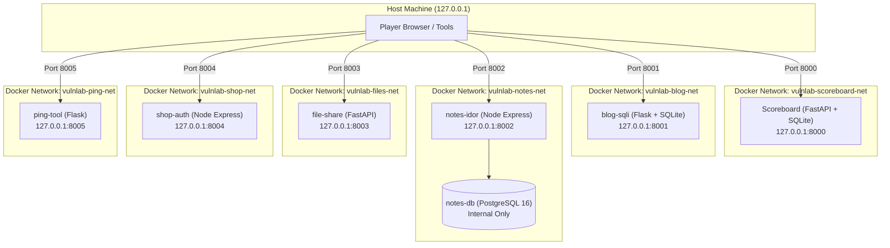

# VulnLab CTF

> [!CAUTION]
> ### ⚠️ Intentionally vulnerable, never expose to a public network.
> VulnLab CTF contains deliberately vulnerable code, insecure configurations, and exploit vectors designed exclusively for local educational cybersecurity training, vulnerability research, and penetration testing practice.
>
> All containers are strictly hardcoded to bind to host loopback (`127.0.0.1`). **DO NOT** reconfigure services to listen on `0.0.0.0`, port-forward them through routers/gateways, or deploy them onto untrusted networks or internet-facing hosts.

---

## Architecture & Network Isolation

VulnLab CTF consists of **5 isolated vulnerable web applications**, **1 dedicated PostgreSQL database**, and **1 centralized Scoreboard**. 

To enforce strict security and prevent lateral exploitation between challenges or compromise of the host machine:
- **Zero Cross-Talk**: Each vulnerable application operates within its own dedicated Docker bridge network.
- **Scoreboard Isolation**: The Scoreboard has **no network route** into any vulnerable application's container network.
- **No Direct DB Exposure**: The PostgreSQL database (`notes-db`) does not expose any host ports and is accessible solely by `notes-idor` over `vulnlab-notes-net`.
- **Restricted Storage**: No host directories are bind-mounted into containers. All persistence is managed via isolated Docker named volumes.
- **Resource Constraints**: Every service is capped at 0.50 CPU cores and 256MB RAM.



---

## Service Registry & Port Allocations

| Service | Host Port | Technology | Isolated Docker Network | OWASP Categories |
|---|---|---|---|---|
| **Scoreboard** | `127.0.0.1:8000` | FastAPI, SQLite, Tailwind | `vulnlab-scoreboard-net` | CTF Hub, Flag Verification & Hints |
| **blog-sqli** | `127.0.0.1:8001` | Flask, SQLite, Jinja2 | `vulnlab-blog-net` | A03:2021-Injection (SQLi & Stored XSS) |
| **notes-idor** | `127.0.0.1:8002` | Express.js, PostgreSQL 16 | `vulnlab-notes-net` | A01:2021-Broken Access Control (IDOR) |
| **notes-db** | *None* | PostgreSQL 16 (Alpine) | `vulnlab-notes-net` | Internal Database Backend |
| **file-share** | `127.0.0.1:8003` | FastAPI, Python 3.12 | `vulnlab-files-net` | A01: Broken Access Control, A03: Upload |
| **shop-auth** | `127.0.0.1:8004` | Express.js, Node.js 20 | `vulnlab-shop-net` | A07:2021-Auth Failures (JWT, Brute Force) |
| **ping-tool** | `127.0.0.1:8005` | Flask, Python 3.12 | `vulnlab-ping-net` | A03: Command Injection, A10: SSRF, XSS |

---

## Difficulty Levels

Every vulnerable application dynamically adapts its vulnerability surface and defenses based on the active difficulty setting:

- **Easy (100 pts)**: Baseline vulnerabilities with minimal or nonexistent input sanitization.
- **Medium (200 pts)**: Common partial defenses (e.g., naive regex blacklists, single-pass filtering, client-side validation).
- **Hard (300 pts)**: Advanced defenses requiring filter evasion, alternate character encodings, parameter pollution, or second-order vectors.

### Configuring Difficulty
Difficulty can be set globally or per application in `.env`:
```bash
# Global setting:
DIFFICULTY=easy    # Options: easy | medium | hard

# Optional per-app overrides:
BLOG_SQLI_DIFFICULTY=easy
NOTES_IDOR_DIFFICULTY=medium
FILE_SHARE_DIFFICULTY=hard
SHOP_AUTH_DIFFICULTY=easy
PING_TOOL_DIFFICULTY=easy
```

---

## Flag Format & Secret Management

- **Flag Format**: `VULNLAB{<32-hex-lowercase>}` (e.g., `VULNLAB{37df5454176e720f332c36f6bada0f9f}`).
- **Zero Plaintext Persistence**: Plaintext flags are **never** stored in the scoreboard database.
- **HMAC Verification**: The scoreboard verifies flags using HMAC-SHA256 digests generated from a cryptographically secure 64-hex `SCOREBOARD_SECRET`.
- **Dynamic Flag Generation**: Flags are generated automatically into `.env` (gitignored, mode `0600`) via `scripts/gen-flags.sh`.

---

## Quick Start Guide

### Prerequisites
- Docker Engine 24+ and Docker Compose v2.20+
- Bash / POSIX compatible shell
- `curl` or `wget`

### 1. Launch the Lab
Run the automated startup script:
```bash
./scripts/start.sh
```
This script will:
1. Verify permissions and generate a fresh `.env` with random flags if one does not already exist.
2. Build all Docker images.
3. Start all services in the background.
4. Poll all service healthcheck endpoints (`/health`) until all containers are fully ready.
5. Print service URLs and access details.

### 2. Access the Applications
Open your browser to:
- **Scoreboard**: [http://127.0.0.1:8000](http://127.0.0.1:8000)
- **Blog SQLi**: [http://127.0.0.1:8001](http://127.0.0.1:8001)
- **Notes IDOR**: [http://127.0.0.1:8002](http://127.0.0.1:8002)
- **File Share**: [http://127.0.0.1:8003](http://127.0.0.1:8003)
- **Shop Auth**: [http://127.0.0.1:8004](http://127.0.0.1:8004)
- **Ping Tool**: [http://127.0.0.1:8005](http://127.0.0.1:8005)

### 3. Stop the Lab
To stop all containers while preserving database state and flags:
```bash
./scripts/stop.sh
```

### 4. Reset the Lab & Rotate Flags
To completely wipe container databases, rotate all 42 challenge flags and secrets, and restart with a clean slate:
```bash
./scripts/reset.sh
```
You can also specify a target difficulty level when resetting:
```bash
./scripts/reset.sh --difficulty=medium
```

---

## Challenge Overview (42 Challenges Total)

### 1. Blog SQLi (`apps/blog-sqli`, Port 8001)
- **Login Bypass**: Easy (`' OR 1=1--`), Medium (keyword filters), Hard (space bypass / alternate syntax).
- **UNION-Based Extraction**: Easy (standard UNION), Medium (comment filters), Hard (column matching & blind extraction).
- **Stored XSS in Comments**: Easy (`<script>`), Medium (attribute event handlers), Hard (sanitization bypass).

### 2. Notes IDOR (`apps/notes-idor`, Port 8002)
- **Note Access IDOR**: Easy (sequential ID), Medium (encoded/UUID guessing), Hard (parameter pollution / second-order).
- **Privilege Escalation**: Easy (role manipulation), Medium (profile patch injection), Hard (mass assignment / token bypass).

### 3. File Share (`apps/file-share`, Port 8003)
- **Path Traversal**: Easy (`../`), Medium (nested traversal `....//`), Hard (URL encoding / null byte / normalization).
- **Unrestricted Upload**: Easy (arbitrary extension), Medium (extension blacklist), Hard (double extension / magic byte bypass).
- **Weak MIME Validation**: Easy (client header bypass), Medium (sniffing confusion), Hard (polyglot payloads).

### 4. Shop Auth (`apps/shop-auth`, Port 8004)
- **JWT Vulnerabilities**: Easy (`alg: none`), Medium (weak secret brute-force), Hard (key confusion / algorithm spoofing).
- **Login Rate-Limiting**: Easy (no rate limit), Medium (header bypass `X-Forwarded-For`), Hard (timing / concurrency race).
- **Password Reset**: Easy (predictable MD5 token), Medium (microsecond timestamp), Hard (host header injection).

### 5. Ping Tool (`apps/ping-tool`, Port 8005)
- **Command Injection**: Easy (semicolon `; id`), Medium (piping `|` and filter evasion), Hard (space-less injection `$IFS`).
- **SSRF**: Easy (`http://localhost`), Medium (IP blacklist bypass `127.0.0.1` -> `0177.0.0.1` / IPv6), Hard (redirects / DNS rebinding).
- **Reflected XSS**: Easy (raw parameter reflection), Medium (tag blacklist bypass), Hard (attribute context breakout).

---

## Safety Controls & Verification

Before deployment or testing, you can verify compliance with the safety constraints:
```bash
# Verify all port bindings are loopback (127.0.0.1) only:
docker compose config | grep -E "published:" -B 2

# Verify no sensitive host directories are mounted:
docker compose config | grep -E "type: bind" || echo "✓ No host bind mounts detected"

# Verify .env permissions:
ls -l .env
```
