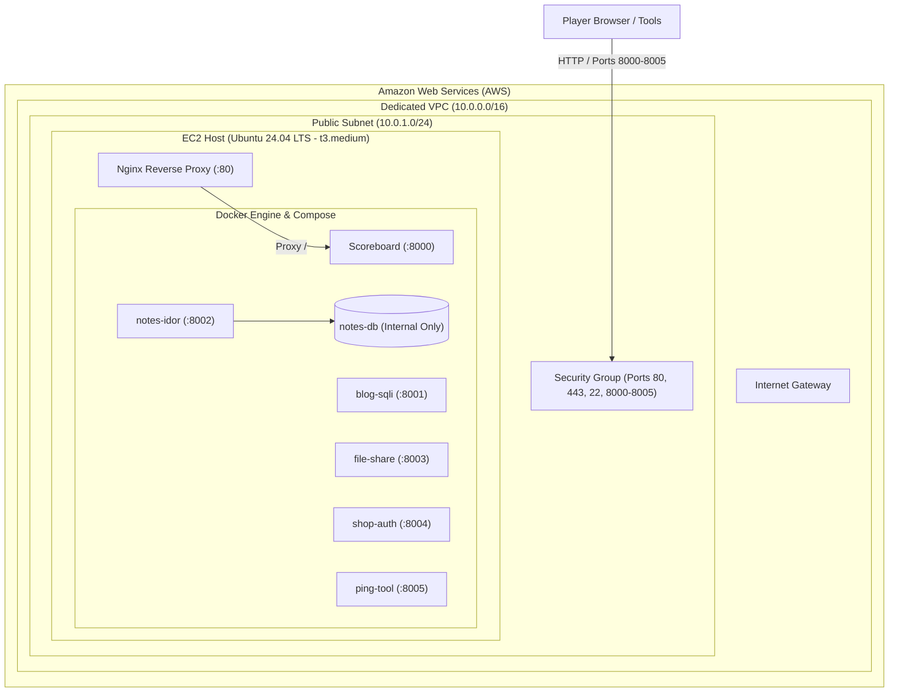

# VulnLab CTF - AWS Terraform Infrastructure

This directory contains production-grade Terraform configurations to provision an isolated AWS architecture and deploy the entire **VulnLab CTF** platform on an EC2 instance.

---

## Architecture Overview



### Components Provisioned
- **VPC**: Isolated `10.0.0.0/16` network with DNS hostnames enabled.
- **Subnet & Route Table**: Public subnet (`10.0.1.0/24`) attached to an Internet Gateway.
- **Security Group**: Controlled ingress for HTTP (80), HTTPS (443), SSH (22), and CTF application ports (`8000`-`8005`).
- **IAM Role & Instance Profile**: Configured with `AmazonSSMManagedInstanceCore` for secure AWS Systems Manager Session Manager access without needing SSH keys.
- **EC2 Instance**: Powered by Ubuntu 24.04 LTS on a `t3.medium` (2 vCPU, 4GB RAM) with 30GB gp3 encrypted root volume.
- **Cloud-Init Automation (`user_data.sh.tftpl`)**:
  - Automatically installs Docker CE, Docker Compose plugin, Git, Curl, JQ, and Nginx.
  - Clones the CTF repository.
  - Rebinds ports from loopback (`127.0.0.1`) to `0.0.0.0` for cloud access.
  - Injects client-side dynamic host resolver so challenge links point directly to the EC2 host.
  - Generates secure random flags and secrets.
  - Sets up Nginx reverse proxy on port 80 pointing to Scoreboard.
  - Builds and starts all 7 Docker containers in detached mode.

---

## Service Registry & Port Allocations

| Service | Port | Direct URL | Description |
|---|---|---|---|
| **Portal / Scoreboard** | `80` | `http://<PUBLIC_IP>` | Main Web UI (Nginx Reverse Proxy) |
| **Scoreboard Direct** | `8000` | `http://<PUBLIC_IP>:8000` | FastAPI Scoreboard Backend & UI |
| **Blog SQLi** | `8001` | `http://<PUBLIC_IP>:8001` | SQLi & Stored XSS Challenge |
| **Notes IDOR** | `8002` | `http://<PUBLIC_IP>:8002` | IDOR & Privilege Escalation Challenge |
| **File Share** | `8003` | `http://<PUBLIC_IP>:8003` | Path Traversal & Arbitrary Upload |
| **Shop Auth** | `8004` | `http://<PUBLIC_IP>:8004` | Broken JWT & Brute Force Challenge |
| **Ping Tool** | `8005` | `http://<PUBLIC_IP>:8005` | Command Injection & SSRF Challenge |

---

## Prerequisites

1. **Terraform**: v1.5.0 or newer ([Install Terraform](https://developer.hashicorp.com/terraform/downloads))
2. **AWS CLI & Credentials**: Configured with permissions to manage EC2, VPC, and IAM resources:
   ```bash
   aws configure
   # or export AWS_ACCESS_KEY_ID / AWS_SECRET_ACCESS_KEY
   ```

---

## Quick Start (Automated Script)

Make the deployment scripts executable and run `deploy.sh`:

```bash
chmod +x terraform/*.sh
./terraform/deploy.sh
```

The script will:
1. Verify your AWS credentials.
2. Generate `terraform.tfvars` from defaults if not present.
3. Run `terraform init`, `terraform validate`, and `terraform plan`.
4. Ask for confirmation before applying.
5. Display all access URLs and poll the healthcheck until the containers are ready!

---

## Manual Deployment

If you prefer running Terraform commands manually:

```bash
cd terraform

# 1. Initialize provider plugins
terraform init

# 2. Configure variables (optional)
cp terraform.tfvars.example terraform.tfvars
# Edit terraform.tfvars to adjust region or allowed_cidr_blocks

# 3. Preview execution plan
terraform plan

# 4. Provision infrastructure
terraform apply

# 5. Output all service URLs
terraform output deployment_summary
```

---

## Monitoring Deployment Progress

During the first 2-3 minutes after provisioning, the EC2 instance runs cloud-init to build the containers. You can inspect the live installation progress using:

```bash
# Via AWS Systems Manager Session Manager:
aws ssm start-session --target <INSTANCE_ID>
tail -f /var/log/vulnlab-user-data.log

# Or via SSH (if key_name was provided):
ssh -i <your-key.pem> ubuntu@<PUBLIC_IP> 'tail -f /var/log/vulnlab-user-data.log'
```

---

## Customization & Variables

You can customize parameters in `terraform.tfvars`:

| Variable | Default | Description |
|---|---|---|
| `aws_region` | `"us-east-1"` | AWS Region to deploy into |
| `instance_type` | `"t3.medium"` | EC2 instance sizing (minimum 4GB RAM) |
| `allowed_cidr_blocks` | `["0.0.0.0/0"]` | IP CIDR whitelist for web access |
| `ssh_cidr_blocks` | `["0.0.0.0/0"]` | IP CIDR whitelist for SSH |
| `key_name` | `""` | Existing AWS Key Pair name for SSH |
| `root_volume_size` | `30` | Root EBS volume size in GB |
| `ctf_difficulty` | `"easy"` | Initial challenge difficulty (`easy`, `medium`, `hard`) |
| `git_repo_url` | `"https://..."` | Git repository URL to clone and deploy |
| `git_branch` | `"main"` | Git branch to deploy |

---

## Teardown & Resource Cleanup

To destroy all AWS resources and prevent recurring charges:

```bash
./terraform/destroy.sh
```

Or manually:
```bash
cd terraform
terraform destroy
```
